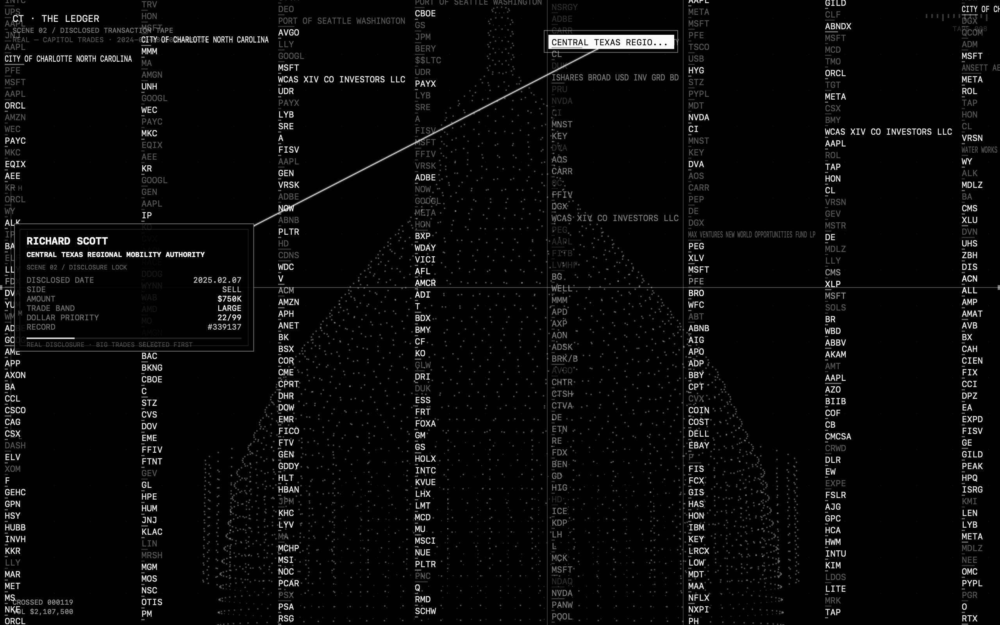

# Capitol Alpha Machine

Politicians' stock trades, turned into monochrome data sculptures and free Mac screensavers.

I worked on [Capitol Trades](https://www.capitoltrades.com/), which tracks stock trades disclosed by members of the US Congress. This project takes those records somewhere else: moving fields of text, lines, and patterns. There's a bit of irony in making something beautiful out of such a controversial subject. I liked that, so I kept going—and turned three of the experiments into screensavers, as originally intended.

**[Explore the website](https://capitolalpha.app/) · [Try the screensavers](https://capitolalpha.app/screensavers) · [Download all three for Mac](https://capitolalpha.app/screensavers/downloads/capitol-alpha-screensavers-mac.zip)**



## The screensavers

| Screensaver | What it shows |
| --- | --- |
| **The Ledger** | A moving field of disclosed trades: members, tickers, transaction types, and value bands. |
| **Returns Spectrum** | Disclosed trades arranged around historical market returns. |
| **Policy Proximity** | Public-law events and trade disclosures connected by timing and sector proximity. |

All three public downloads are free, signed with Developer ID, and notarized by Apple. They include Apple's notarization tickets and individual thumbnails for System Settings. Universal builds support Apple Silicon and Intel Macs running macOS 12 or later; rendering has been tested on macOS 15.6.1.

Unzip a download, double-click its `.saver` file, and choose it in **System Settings → Screen Saver → Other**. No browser needs to stay open. Each saver checks for published data weekly and uses saved or bundled data when offline. Design changes require a new download.

## What I built

- A static website with animated scenes and browser previews.
- Three native macOS screensaver bundles hosting the scenes in WebKit.
- A WebGL2 renderer for the screensavers, with Retina rendering, smooth text motion, and a Canvas fallback.
- Data preparation, generated methodology and scene pages, and a weekly publication pipeline.

The website uses HTML, CSS, and JavaScript. The macOS host uses Objective-C, ScreenSaver, and WebKit; Python handles building and data preparation.

## Run locally

From the repository root, with Python 3 installed:

```sh
python3 -m http.server 8765
```

Open [localhost:8765](http://localhost:8765/) for the website or [localhost:8765/screensavers](http://localhost:8765/screensavers) for the screensavers page.

To build the Mac screensavers, use macOS with Xcode command-line tools installed:

```sh
python3 macos-screensaver/build.py
```

The bundles appear in `build/`. Local builds are ad-hoc signed by default; they do not inherit the public downloads' Apple notarization. Developer ID signing and notarization require your own Apple credentials. See the [screensaver documentation](macos-screensaver/README.md) for build options and the [performance audit](macos-screensaver/PERFORMANCE_AUDIT.md) for measurements and limitations.

## Repository layout

| Path | Purpose |
| --- | --- |
| `index.html` | Main visualization and embedded scene sources. |
| `screensavers/` | Showcase, browser previews, scene images, and public ZIP downloads. |
| `macos-screensaver/` | Native host, rendering support, build and packaging scripts. |
| `scripts/` | Data preparation, page generation, and validation. |
| `capitoltrades_data.js` | Published scene datasets. |
| `data/` | Supporting datasets and policy-event payload. |
| `methodology/` and `scenes/` | Generated explanatory pages. |

## Data and interpretation

Trading disclosures come from Capitol Trades; Policy Proximity also uses Congress.gov public-law records. Data windows differ between scenes. Timing links and scores are visualization heuristics, not evidence of causation or wrongdoing. Disclosed value bands are not exact holdings or profits.

Original source records remain subject to their publishers' terms. See the [methodology and data-use notes](https://capitolalpha.app/methodology#data-use-notes) before reusing the datasets. The project's MIT license does not apply to third-party data.

## Maintenance

The local weekly publication pipeline refreshes trade data and generated pages. Policy Proximity's event payload is prepared separately; it is not regenerated by the regular trade refresh. GitHub Actions checks whether the weekly report was published.

```sh
python3 scripts/refresh_data_and_seo.py
python3 scripts/validate_static_site.py
```

For unattended publication on a Mac, see `scripts/install_weekly_refresh_launchd.sh`. The website deploys from the repository root to Vercel. Keep `.env.local`, `.vercel/`, signing credentials, and temporary builds out of Git.

## Credits

Built by [Sylvain Belahniche](https://github.com/sbelahniche). Shout-out to Markus Klug and Niccolò Prada from my Capitol Trades work.

The WebKit occlusion workaround follows the approach documented by [WebViewScreenSaver](https://github.com/liquidx/webviewscreensaver).

## License

Original project code and documentation are licensed under the [MIT License](LICENSE).

Copyright © 2026 Sylvain Belahniche. Third-party datasets, assets, and code retain their respective rights and terms; the MIT license does not grant rights to those materials.
